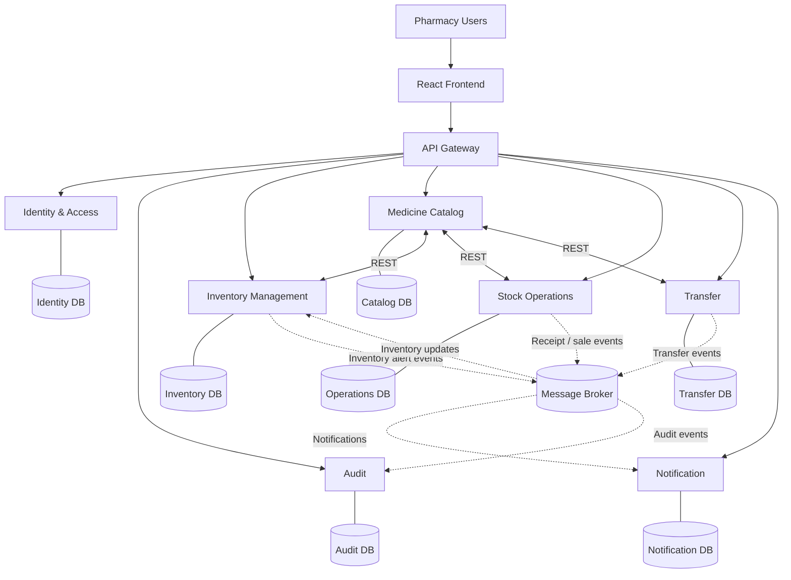

# Gagana Pharmacy Management System
# Microservice Architecture — Version 1

**Status:** Proposed architecture baseline  
**Version:** 1.0  
**Last updated:** 24 November 2026

## 1. Purpose

This document defines the proposed microservices architecture for Gagana Pharmacy's inventory management system. The system supports medicine and batch management, branch-level inventory, stock receipts, sales, stock adjustments, inter-branch transfers, alerts, notifications, user access management and audit logging.

This is an implementation baseline. API contracts, event schemas, database structures and deployment decisions will be refined before coding.

## 2. Architecture goals

- Separate the system into services with clear business responsibilities.
- Give each service ownership of its data.
- Allow services to be developed, tested and deployed independently.
- Prevent direct access to another service's database.
- Support secure, branch-aware access.
- Maintain accurate stock balances and stock movement history.
- Enable parallel development through documented APIs and events.
- Keep the solution achievable within the project timeline.

## 3. Proposed architecture

The system contains seven backend services and one API Gateway. The Gateway is infrastructure, not an eighth business microservice.

1. Identity & Access Service
2. Audit Service
3. Inventory Management Service
4. Medicine Catalog Service
5. Stock Operations Service
6. Transfer Service
7. Notification Service

This is a conceptual diagram. Exact routes, subscriptions and deployment topology will be specified separately.

## 4. Service boundaries

### 4.1 Identity & Access Service

**Lead:** Project technical lead

**Purpose:** Manage user identity, authentication, authorization and organization information.

**Responsibilities:**
- User account creation and management.
- Login, authentication and JWT issuance.
- Password hashing and account security.
- Role management and role-based authorization data.
- Employee, branch and department management.
- Employee-to-branch assignment.
- Providing trusted identity and organization information to other services.

**Owned entities:** `BRANCH`, `DEPARTMENT`, `EMPLOYEE`, `ROLE`, `USER_ACCOUNT`.

**Confirmed assumptions:**
- Each user account has one primary role.
- Each employee belongs to one branch.
- An Admin account may exist without an employee record.
- Branch and employee management remain in this service.

### 4.2 Audit Service

**Lead:** Project technical lead

**Purpose:** Independently store and retrieve important system activity records.

**Responsibilities:**
- Receive audit events from relevant services.
- Store actor, action, entity, timestamp and context.
- Support authorized audit searching and filtering.
- Protect audit records from ordinary business-service modification.

**Owned entity:** `AUDIT_LOG`.

**Deployment:** Independently deployed, with its own database. Other services submit audit events or requests; they do not write directly to the Audit database.

### 4.3 Inventory Management Service

**Lead:** Project technical lead

**Purpose:** Maintain authoritative branch stock quantities and inventory-related rules.

**Responsibilities:**
- Branch inventory by medicine batch.
- Available, reserved and damaged quantities.
- Stock reservations and quantity changes.
- Approved stock adjustments.
- Stock transaction history.
- Low-stock, near-expiry and expired-stock monitoring.
- Branch-specific reorder thresholds.
- Expiry alert settings and inventory alert lifecycle.

**Owned entities:** `BRANCH_INVENTORY`, `BRANCH_MEDICINE_SETTING`, `EXPIRY_ALERT_SETTING`, `ALERT` and its subtypes, `STOCK_ADJUSTMENT`, `STOCK_TRANSACTION`.

**Key rule:** Inventory is the only service that changes authoritative inventory balances. Operations and Transfer initiate stock workflows but do not directly update Inventory tables.

### 4.4 Medicine Catalog Service

**Lead:** Nethmini

**Purpose:** Maintain medicine master data and batch information.

**Responsibilities:**
- Medicine registration and updates.
- Batch numbers and dates.
- Batch-level price information.
- Batch price history.
- Medicine and batch lookup APIs.

**Owned entities:** `MEDICINE`, `MEDICINE_BATCH`, `BATCH_PRICE_HISTORY`.

### 4.5 Stock Operations Service

**Lead:** Sahan

**Purpose:** Manage the workflows through which stock enters and leaves a branch during normal operations.

**Responsibilities:**
- Stock receipt creation and processing.
- Receipt item management and approval.
- Sales processing and sale item management.
- Request stock validation, reservation or deduction from Inventory.
- Publish events after relevant operations complete.

**Owned entities:** `STOCK_RECEIPT`, `STOCK_RECEIPT_ITEM`, `SALE`, `SALE_ITEM`.

**Key rule:** Operations owns receipt and sale records, not inventory balances.

### 4.6 Transfer Service

**Lead:** Supporting pair, under technical lead review

**Purpose:** Manage stock transfers between branches.

**Responsibilities:**
- Transfer requests and approval workflow.
- Source and destination validation.
- Coordination of stock reservation and dispatch with Inventory.
- Dispatch and destination receipt confirmation.
- Transfer discrepancies and status tracking.

**Owned entities:** `STOCK_TRANSFER`, `STOCK_TRANSFER_ITEM`.

**Key rule:** Transfer owns the transfer workflow; Inventory owns stock reservations and quantity changes.

### 4.7 Notification Service

**Lead:** Supporting pair, under technical lead review

**Purpose:** Manage user-specific notifications and their read status.

**Responsibilities:**
- Receive notification requests/events.
- Create notifications for appropriate users.
- Manage read/unread status.
- List and filter notifications.
- Provide a boundary for future delivery channels if required.

**Owned entity:** `NOTIFICATION`.

An Inventory alert represents an inventory condition. A Notification represents a message delivered to a user. One alert may produce multiple notifications; an administrative notification may have no alert reference.

## 5. API Gateway

The API Gateway is the entry point for the React frontend.

**Responsibilities:**
- Route requests to the appropriate service.
- Apply common request-level policies where appropriate.
- Validate or verify access tokens as part of the trusted authentication design.
- Forward trusted identity context.
- Apply rate limits and request-size limits where required.
- Provide consistent external routing.

The Gateway must not own business data or replace service-level authorization. Each service remains responsible for enforcing its own business permissions.

## 6. Database ownership

Each service owns its data and is the only service permitted to modify it.

| Service | Database |
|---|---|
| Identity & Access | Identity DB |
| Audit | Audit DB |
| Inventory Management | Inventory DB |
| Medicine Catalog | Catalog DB |
| Stock Operations | Operations DB |
| Transfer | Transfer DB |
| Notification | Notification DB |

The databases may initially run on one SQL Server instance. Logical ownership must remain separate.

Rules:
- No service directly reads or writes another service's tables.
- A service may store another service's identifier as an external reference.
- Relationships inside one service database may use normal SQL foreign keys.
- Cross-service relationships are validated through APIs or trusted events.
- Local read models or snapshots may be used when justified, but the source service remains authoritative.

## 7. Communication patterns

### 7.1 Synchronous REST

Use REST when the caller needs an immediate response, such as:
- Looking up medicine or batch details.
- Validating a branch or user reference.
- Checking batch eligibility.
- Requesting a stock reservation or deduction.

Synchronous calls need timeouts and clear error handling. Do not retry non-idempotent operations without an idempotency strategy.

### 7.2 Asynchronous events

Use events when a completed operation must be communicated to other services independently.

Proposed events:
- `StockReceiptApproved`
- `SaleProcessed`
- `TransferApproved`
- `TransferDispatched`
- `TransferReceived`
- `LowStockDetected`
- `NearExpiryDetected`
- `ExpiredStockDetected`
- Audit submissions from relevant services

A broker such as RabbitMQ is under evaluation, not yet confirmed.

### 7.3 Reliability

Asynchronous processing must account for duplicate delivery, retries, idempotent consumers, ordering where required, dead-letter handling, event versioning and correlation IDs.

For important changes that must reliably produce events, evaluate the transactional outbox pattern: save the business change and an outbox message in the same local transaction, then publish the message separately.

## 8. Key business workflows

### 8.1 Stock receipt

1. Staff submits a receipt through the frontend.
2. Gateway routes the request to Stock Operations.
3. Operations validates and approves the receipt according to its workflow.
4. Operations publishes `StockReceiptApproved` after the approval is committed.
5. Inventory processes the event and updates branch stock.
6. Inventory records the stock transaction and evaluates alert conditions.
7. Notification creates user notifications where appropriate.
8. Relevant actions are submitted to Audit.

Duplicate event delivery must not increase stock twice.

### 8.2 Sale

1. Staff submits a sale.
2. Operations validates the sale request.
3. Catalog provides or validates medicine and batch details where required.
4. Inventory validates and atomically deducts the required quantity.
5. Operations records the completed sale and sale items.
6. Relevant stock and audit records are produced.

The exact coordination must be designed carefully. A completed sale must not exist without a successful stock deduction. Do not assume a distributed SQL transaction.

### 8.3 Branch transfer

1. Staff creates a transfer request.
2. Transfer validates source and destination branches.
3. Source manager approves the request.
4. Transfer requests Inventory to reserve source stock.
5. Transfer records dispatch.
6. Inventory processes the source stock movement.
7. Destination staff confirms received quantities.
8. Inventory adds accepted quantities to destination stock.
9. Transfer records discrepancies and final status.
10. Relevant notifications and audit records are generated.

Source and destination must differ. Shortages, partial dispatch, rejected quantities and failed deliveries need explicit rules.

## 9. Security principles

- Identity & Access is authoritative for accounts and roles.
- The initial model has one primary role per user account.
- Each employee has one assigned branch.
- JWTs must be signed, validated and have appropriate expiry.
- Passwords must use a suitable one-way password hashing algorithm.
- The Gateway may validate tokens, but each service enforces its own business authorization.
- Branch scope must come from trusted identity data, not blindly from frontend input.
- Service-to-service communication must be authenticated.
- Secrets must not be committed to source control.
- Audit access must be restricted.

## 10. Technology direction

| Layer | Proposed technology |
|---|---|
| Frontend | React |
| Backend | C# / ASP.NET Core Web API |
| Database | Microsoft SQL Server |
| Data access | Entity Framework Core where appropriate |
| API Gateway | To be selected |
| Messaging | RabbitMQ under evaluation |
| Containerization | Docker |
| Source control | Git and GitHub |
| CI | GitHub Actions |

Unconfirmed choices remain open until validated with a proof of concept.

## 11. Team ownership

| Responsibility | Lead |
|---|---|
| Identity & Access | Project technical lead |
| Audit | Project technical lead |
| Inventory Management | Project technical lead |
| API Gateway and integration coordination | Project technical lead |
| Medicine Catalog | Nethmini |
| Stock Operations | Sahan |
| Transfer | Supporting pair under lead review |
| Notification | Supporting pair under lead review |

Each lead owns requirements, API contracts, database design, implementation review, tests and integration readiness. Supporting developers should own concrete implementation tasks and submit work through pull requests.

## 12. Implementation principles

1. Finalize service boundaries and API/event contracts before parallel implementation.
2. Build one end-to-end vertical slice before expanding all services.
3. Keep service projects independently buildable and testable.
4. Make database ownership explicit.
5. Use feature branches and pull requests into `dev`.
6. Require CI checks and review before merging.
7. Integrate frequently.
8. Prioritize core inventory workflows over optional infrastructure.
9. Avoid infrastructure the team cannot operate or test within the project timeline.

## 13. Open decisions

- Separate SQL Server databases versus isolated schemas during the first implementation phase. Separate databases are preferred for clear ownership.
- Whether RabbitMQ will be used.
- Whether audit submissions initially use synchronous HTTP, asynchronous messaging or a staged approach.
- API Gateway technology.
- Exact deployment and local development topology.
- Exact API endpoints, DTOs, event payloads and error contracts.

## 14. Conclusion

The proposed architecture separates Gagana Pharmacy into seven services with explicit ownership. Inventory owns stock balances, Catalog owns medicine and batch data, Operations owns receipts and sales, Transfer owns transfer workflows, Identity owns identity and organization data, Audit owns audit records, and Notification owns user-specific messages.
